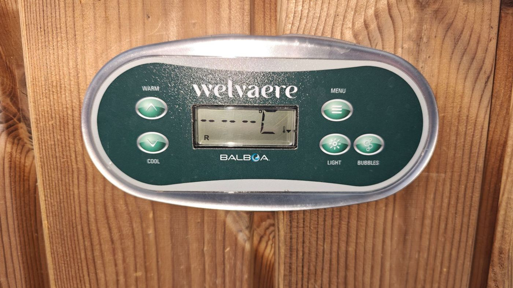
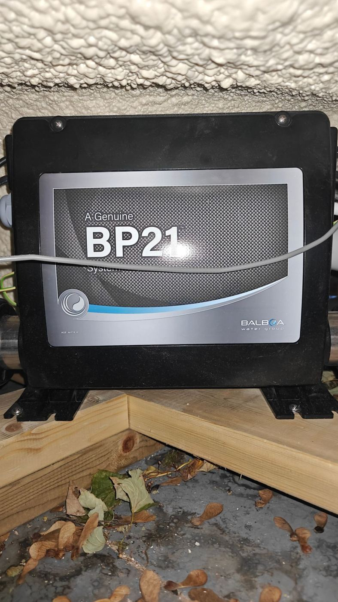
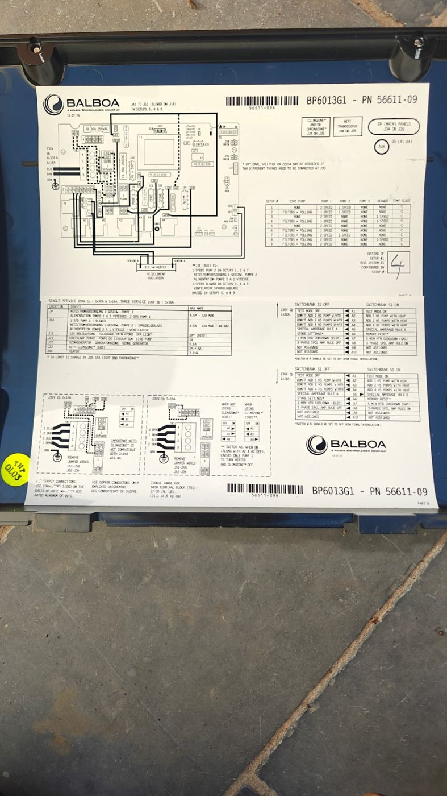
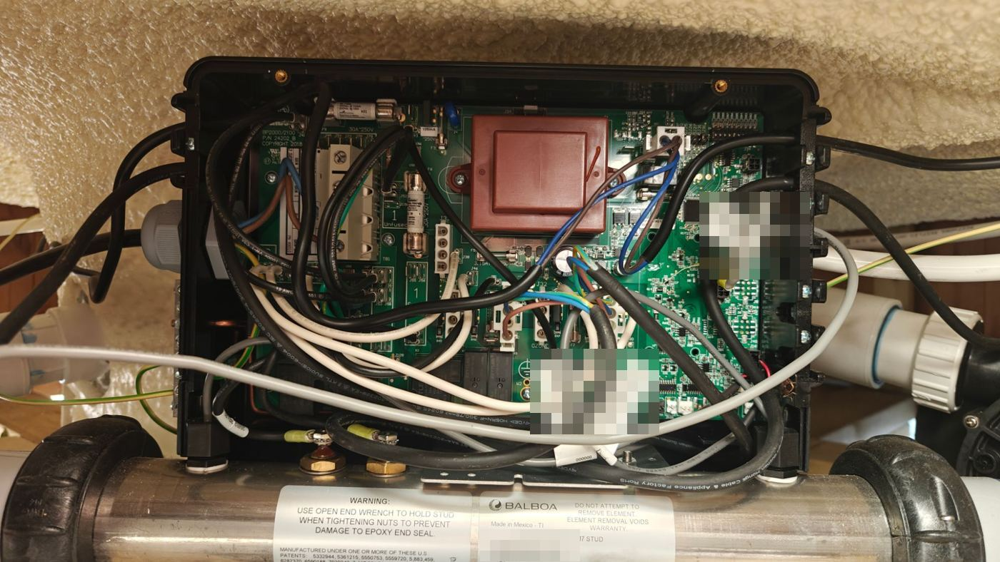
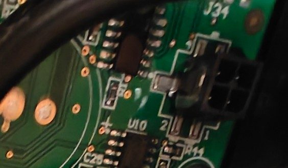
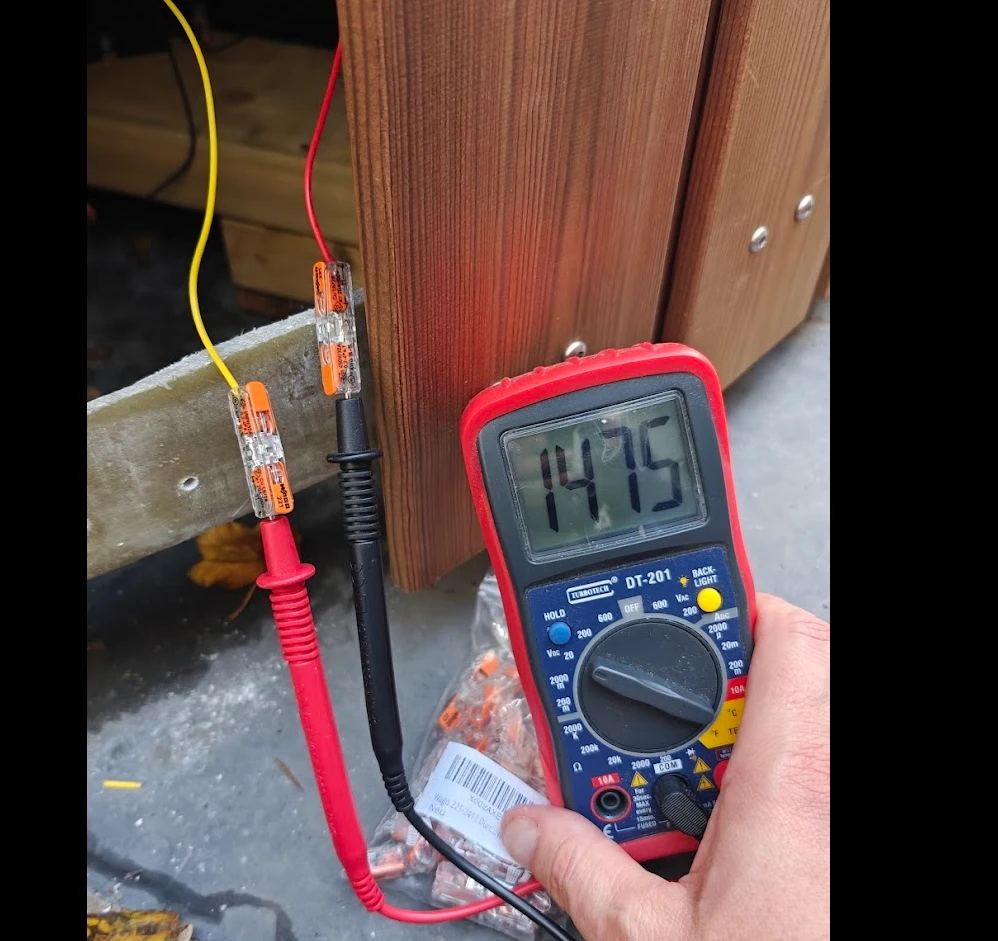
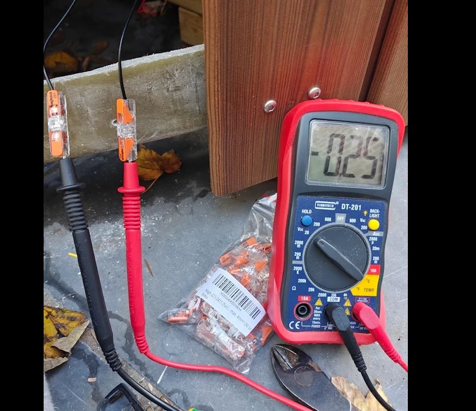

# Piloter un spa Balboa depuis Home Assistant avec un ESP32

Ce guide retrace l'intégration d'un ESP32 sur le bus de commande d'un bain nordique hybride
(feu de bois + résistance électrique) équipé d'une électronique Balboa. Il complète l'intégration
Bain nordique, mais il est indépendant : il fonctionne sans elle.

> ⚠️ **Sécurité.** Le boîtier Balboa contient du 230 V à côté du bus basse tension. Coupez le
> disjoncteur avant d'ouvrir le boîtier et avant chaque branchement sur la carte. Ce montage est
> un retour d'expérience sur **une** installation, sans garantie. Il peut affecter la garantie du spa.

## Ce que ça apporte

| Avant | Après |
|---|---|
| Écran Balboa peu lisible, température souvent masquée | Température, consigne et états dans Home Assistant |
| Réglage de la consigne par les menus de l'écran | Consigne, mode Ready/Rest et plage depuis un tableau de bord |
| Lumière et bulles uniquement depuis l'écran | Boutons Lumière et Bulles sur le téléphone, pour toute la famille |
| Aucune visibilité sur la chauffe et la circulation | Chauffe, pompe de circulation et défauts historisés |

Aucune modification du spa : l'ESP32 se branche sur un port libre, l'écran d'origine continue de fonctionner.

## Le système



L'autocollant « BP21 » du boîtier n'est qu'un habillage. **La référence utile est sur l'étiquette
collée dans le couvercle** : ici une **BP6013G1, PN 56611-09**, carte `BP2000/2100 P/N 24202_B`,
réchauffeur de 3 kW. Les ports changent selon la variante : cherchez la fiche technique de la vôtre
sur [balboawater.com](https://balboawater.com/wp-content/uploads/2025/03/BP6013G1-Current.pdf).

<p>
  
  
</p>

Le numéro écrit à la main sur l'étiquette est le **Setup** : ici le 4 (pompe de circulation qui
alimente le réchauffeur, pompe 1 à une vitesse, soufflerie).



### Les ports de cette carte

| Port | Usage | |
|---|---|---|
| **J34** | Bus principal, libre ici | ✅ L'ESP32 se branche ici |
| **J35** | Bus principal, occupé par l'écran | Ne pas y toucher |
| **J5** | Bus auxiliaire | Non utilisé |
| **J33** | **Sortie 230 V permanente** | ⛔ Jamais |



## Matériel

| Article | Référence | Remarque |
|---|---|---|
| ESP32 | M5Stack **ATOM Lite** (C008) | |
| Interface RS-485 | M5Stack **ATOMIC RS485 Base** (A131) | Abaisseur intégré (6–24 V vers 5 V), direction automatique |
| Câble | Cordon **Micro-Fit 3.0, 2×2, 4 broches**, côté carte à trous | Le cordon utilisé a été coupé d'un côté. Une rallonge d'écran Balboa 25662 convient aussi |
| Boîtier | Boîtier plastique IP65 avec presse-étoupe | **Pas de métal**, il bloquerait le Wi-Fi |
| Outils | Multimètre, connecteurs Wago, ruban pour repérer les fils | |

Le module RS-485 doit avoir une **direction automatique** : le composant ESPHome ne gère pas de
broche DE/RE, et un simple module MAX485 ne pourrait pas émettre.

L'ESP32 reste **hors du boîtier Balboa**, dans son propre boîtier fixé à la structure, à l'abri, avec
le presse-étoupe vers le bas. Un presse-étoupe ne serre correctement que sur une gaine ronde : avec
des fils séparés, ajoutez une gaine thermorétractable au passage.

## Câblage

Le bus est un RS-485 à 115200 bauds, 8N1. Brochage du connecteur, d'après
[la rétro-ingénierie du protocole](https://github.com/ccutrer/balboa_worldwide_app/wiki) :

```text
 Carte Balboa (J34, 2×2)              Base A131 (bornier 4 points)

 Broche 1  +12 à 15 V  ───────────────  DC 24V
 Broche 4  Masse (0 V) ───────────────  G
 Broche 2  RS-485 B    ───────────────  B   (voir l'inversion ci-dessous)
 Broche 3  RS-485 A    ───────────────  A
```

**Ne vous fiez ni aux couleurs ni à la position des fils.** Le cordon utilisé ici vient d'une
alimentation ATX : le +14,75 V était sur le **jaune**, la masse sur le **rouge**, et le bus sur les
**deux fils noirs**. Une erreur sur les couleurs enverrait 14 V sur le bus.

### Identifier les fils au multimètre

Numérotez les fils, branchez le cordon sur J34 disjoncteur coupé, sortez les fils isolés hors du
boîtier, refermez, puis remettez le courant. En V DC :

1. Cherchez la paire à **+12–15 V** : sonde rouge sur le +, sonde noire sur la masse.
2. Mesurez chacun des deux autres fils par rapport à la masse : environ **2 à 3 V**. L'écart entre eux
   était ici de 0,25 V.
3. Coupez le disjoncteur, débranchez l'USB de l'ATOM et raccordez selon l'étiquette de la A131 : son bornier
   est marqué, dans l'ordre, **B, A, DC 24V, G**. La même étiquette rappelle les broches RX 22 et TX 19.

<p>
  
  
</p>

> **A et B inversés : sur ce montage, le fil le plus haut en tension va sur le « A » de la A131**, à
> l'inverse de ce que suggère le brochage ci-dessus. Le premier branchement ne donnait rien (écran
> normal, aucune trame). Permuter les deux fils, disjoncteur coupé, a suffi. Cette inversion n'a rien abîmé.

## ESPHome

Configuration complète : [`esphome/spa-balboa.yaml`](../esphome/spa-balboa.yaml), basée sur le composant
[`brianfeucht/esphome-balboa-spa`](https://github.com/brianfeucht/esphome-balboa-spa). Ajoutez ses
secrets (`spa_balboa_api_key`, `spa_balboa_ota_password`, `spa_balboa_ap_password`), flashez une première
fois en USB **sans le bus branché**, puis les mises à jour passent par le Wi-Fi.

Réglages qui ont compté sur cette carte :

| Réglage | Pourquoi |
|---|---|
| `tx_pin: GPIO19`, `rx_pin: GPIO22` | Broches de la A131 sur un ATOM Lite. Un AtomS3 Lite utilise TX 6 / RX 5 |
| `rx_buffer_size: 512` | En esp-idf, une valeur trop basse provoque des redémarrages en boucle |
| `baud_rate: 0` | Les logs USB ralentiraient la lecture du bus |
| `BalboaSpa.component: ERROR` | Sans bus, le message « No new message » sort environ 100 fois par seconde. Ce filtre masque aussi les détails du bus : repassez en `DEBUG` pour un diagnostic |
| `discard_updates: 100`, `max_toggle_attempts: 3` (bulles) | Voir ci-dessous |
| `wifi: use_address` | Si le Builder voit l'appareil hors ligne faute de résoudre son nom `.local` |

**Bulles qui se rallument.** La commande est une bascule. La carte met environ 0,7 s à l'appliquer,
alors que le composant renvoie l'ordre toutes les 0,2 s par défaut : quatre envois ramenaient les bulles
à leur état de départ. Attendre environ 1,1 s avant de réessayer a supprimé le problème, avec une contrepartie :
l'interrupteur dans Home Assistant se met à jour environ 1 s après l'état réel.

## Home Assistant

Une fois l'appareil ajouté, Home Assistant expose le thermostat, la lumière, les bulles, les états et les défauts.

### Comprendre Ready, Rest et les plages

Ce sont **deux réglages indépendants** :

| Réglage | Il décide… | Valeurs |
|---|---|---|
| **Mode** | **quand** le spa a le droit de chauffer | **Ready** : dès que nécessaire. **Rest** : seulement pendant les filtrations |
| **Plage** | **quelle consigne** s'applique | **Haute** ou **Basse**, chacune mémorise la sienne |

D'après la fiche de cette carte, les limites par défaut sont de 26,5 à 40 °C en plage haute et de
10 à 37 °C en plage basse. Le bus ne donne que la consigne de la **plage active**.

Dans l'entité `climate`, le mode **Off correspond à Rest**, pas à un spa éteint. Pour éviter cette
confusion, deux [helpers Template](https://www.home-assistant.io/integrations/template/) de type
Select, créés depuis l'interface, offrent de vrais libellés (remplacez `climate.spa_balboa_thermostat`
par votre entité) :

| | État | Options | Action |
|---|---|---|---|
| **Spa Mode** | `{{ 'Rest' if is_state('climate.spa_balboa_thermostat', 'off') else 'Ready' }}` | `{{ ['Ready', 'Rest'] }}` | `climate.set_hvac_mode`, avec `hvac_mode: "{{ 'off' if option == 'Rest' else 'heat' }}"` |
| **Spa Plage** | `{{ 'Haute' if is_state_attr('climate.spa_balboa_thermostat', 'preset_mode', 'home') else 'Basse' }}` | `{{ ['Basse', 'Haute'] }}` | `climate.set_preset_mode`, avec `preset_mode: "{{ 'home' if option == 'Haute' else 'eco' }}"` |

### Tableaux de bord

Deux niveaux d'accès :

- **Famille** (tableau partagé) : tuiles Lumière et Bulles, température et états en lecture seule.
- **Pilotage complet** (réservé aux administrateurs) : consigne, Mode, Plage, Lumière, Bulles, chauffe,
  circulation, dernier défaut, journal de défauts, historique.

Conditionnez ces sections à `Bus connecté = on` : quand le bus est perdu, les capteurs binaires du
composant passent à tort à « on ». Un badge d'alerte `Bus connecté ≠ on` signale la perte de liaison.

### Avec l'intégration Bain nordique

La température Balboa est disponible dans l'attribut `current_temperature` du thermostat. Pour l'utiliser
comme sonde d'eau ou la tracer sur un graphe, il faut d'abord en faire un capteur (helper Template).

## Limites à connaître

- **La mesure n'est valable que si l'eau circule.** Les sondes sont sur le réchauffeur, pas dans la
  cuve : il faut une à deux minutes de pompe pour une valeur à jour. En Ready, la pompe relève la
  température environ toutes les 30 minutes. En Rest, seulement pendant les filtrations.
- **La valeur reste figée sans le dire.** Quand la carte ne connaît pas la température (`--` à l'écran),
  le composant garde la dernière valeur connue. L'historique de la pompe de circulation permet d'en juger.
- **Sauts de température.** Le composant retient un écart de plus de 5 °C jusqu'à ce qu'il soit stable
  pendant 60 s.
- **Feu de bois.** Pendant une flambée, la sonde Balboa ne voit la montée qu'au passage de la pompe.
  Une sonde dédiée reste la seule mesure continue.
- **Pas d'horloge temps réel** sur la BP6013G1 d'après sa fiche : les fonctions d'heure du composant
  peuvent être peu fiables. Elles ne sont pas utilisées ici.
- **Éclairage** : la sortie est en tout ou rien, sans variation d'intensité.
